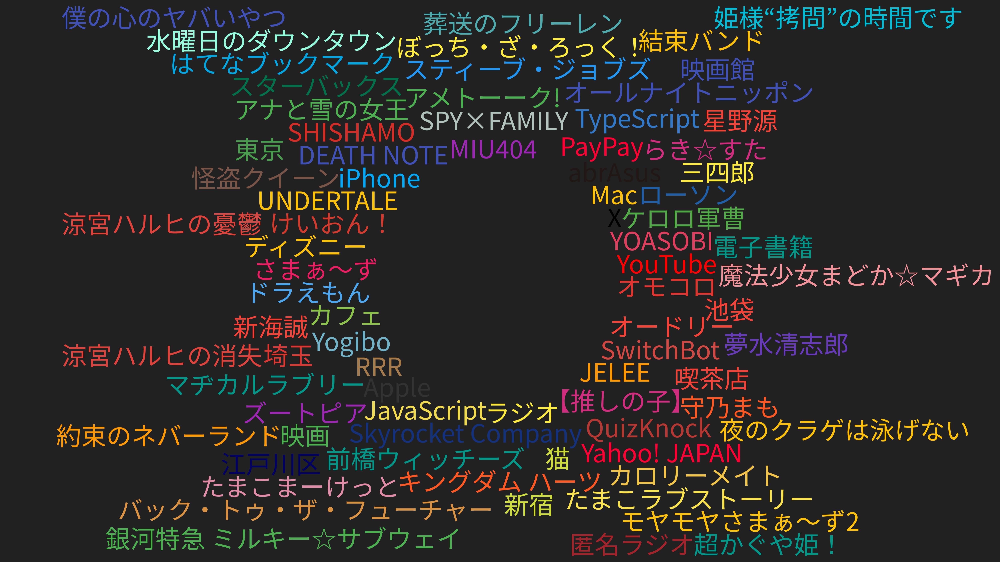
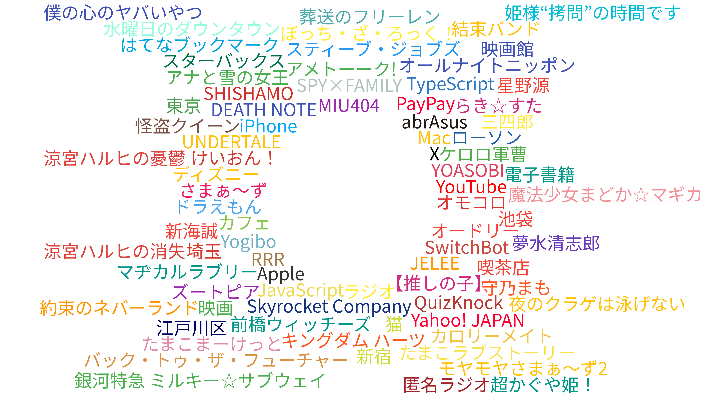
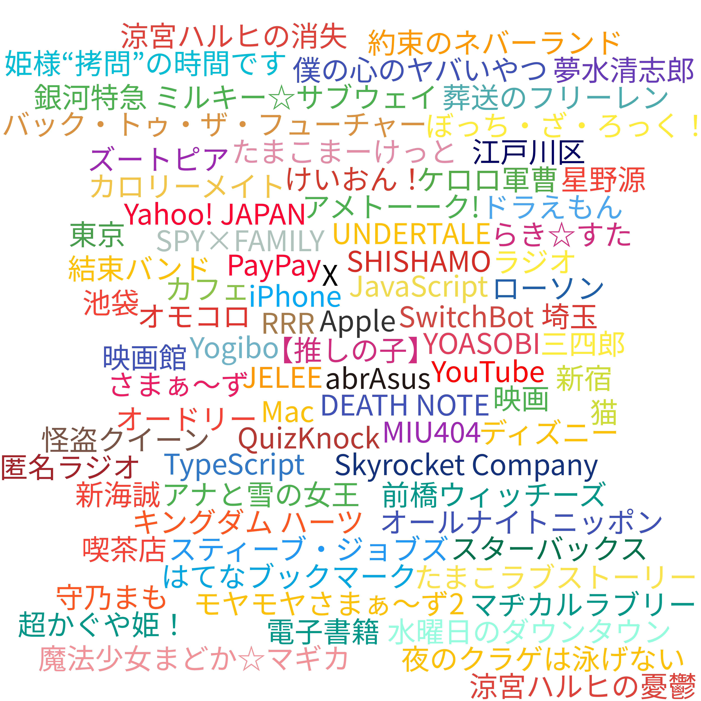
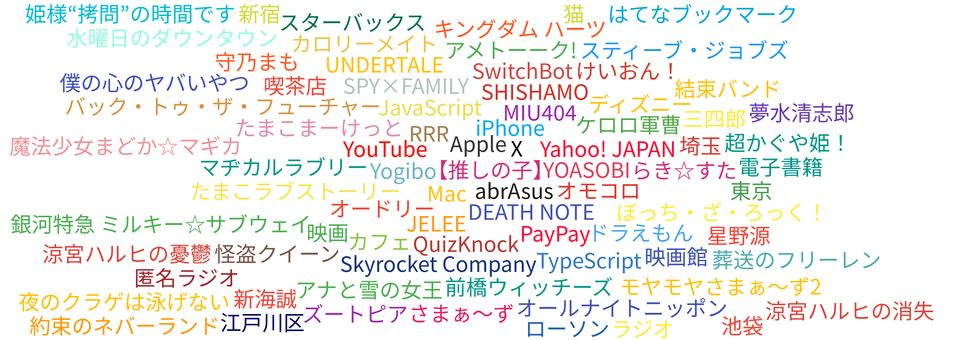
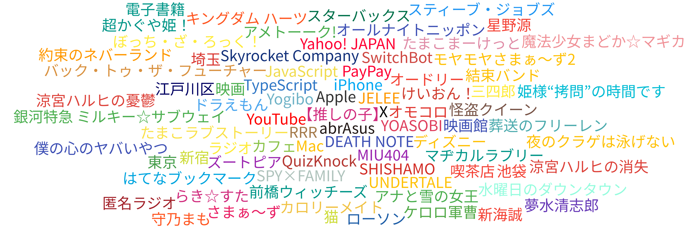
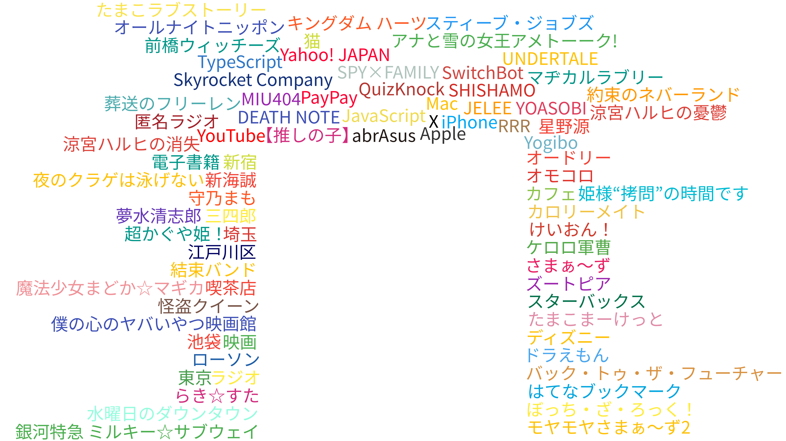
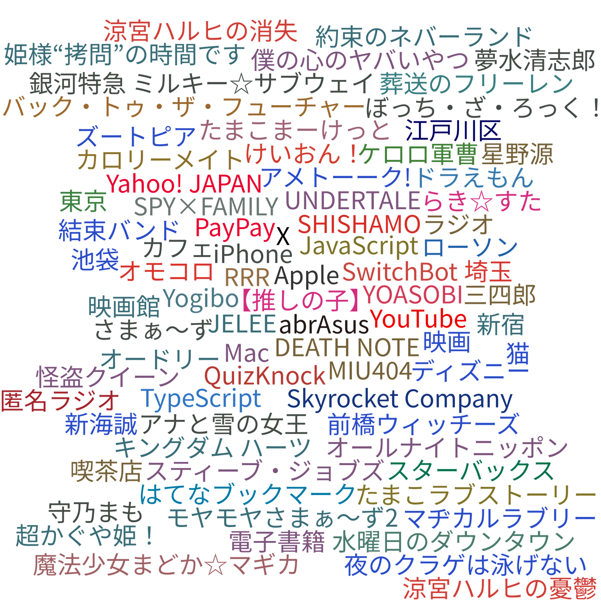
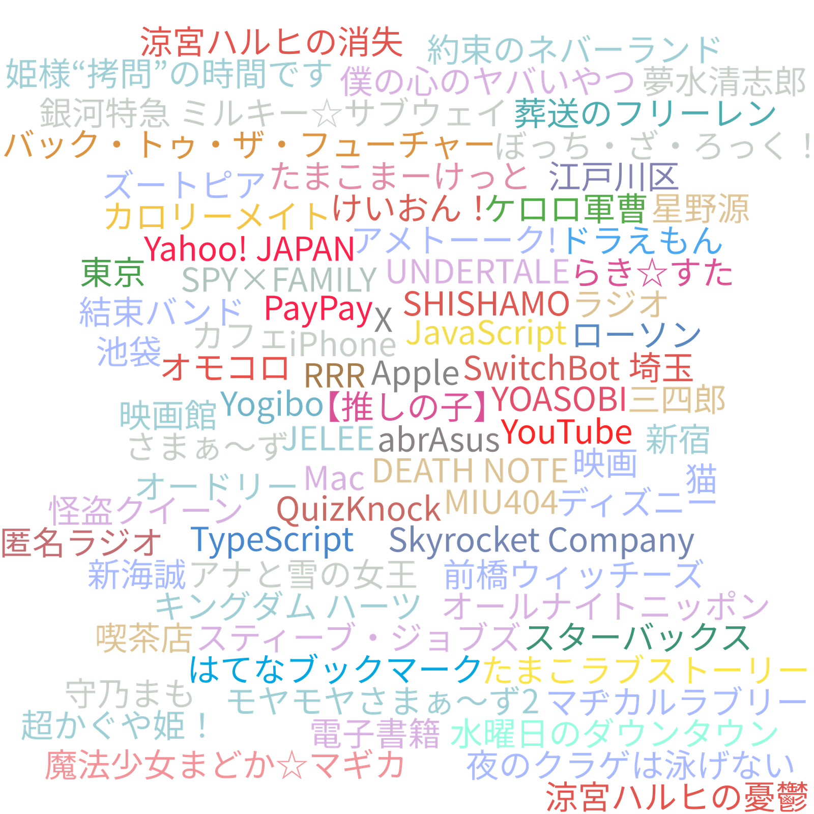

[](https://github.com/munierujp/wordcloud/actions/workflows/lint.yml)
[](https://github.com/munierujp/wordcloud/actions/workflows/test.yml)
[](https://github.com/neostandard/neostandard)

# wordclouds

☁️ My word clouds

## Google Slides
### Dark



### Light



## Square



## Tabelog



## X



## Zoom



## munieru.jp

`munieru-jp-light` / `munieru-jp-dark` は munieru.jp 用の正方形・透過PNGです。
背景色 `#faf9f6` / `#191c1e` に合わせて、CSVの各単語の指定色を
コントラスト比4.5:1以上になるよう補正します。指定色のない単語にはテーマ別の配色を使います。
`data/words.csv` が単語・重み・URLの元データで、既存の画像用の色指定は変更しません。

```sh
npm start -- --profile munieru-jp-light
npm start -- --profile munieru-jp-dark
```

通常の `npm start` でも両プロファイルを生成します。
生成物は `data/munieru-jp-light.png` / `data/munieru-jp-dark.png` と、
WordClouds.comで開ける同名の `.wcld3` ファイルです。画像の最大幅は1600pxです。
サイト側では `prefers-color-scheme` に応じて画像を切り替え、背景は透過のまま表示します。

### Light



### Dark


